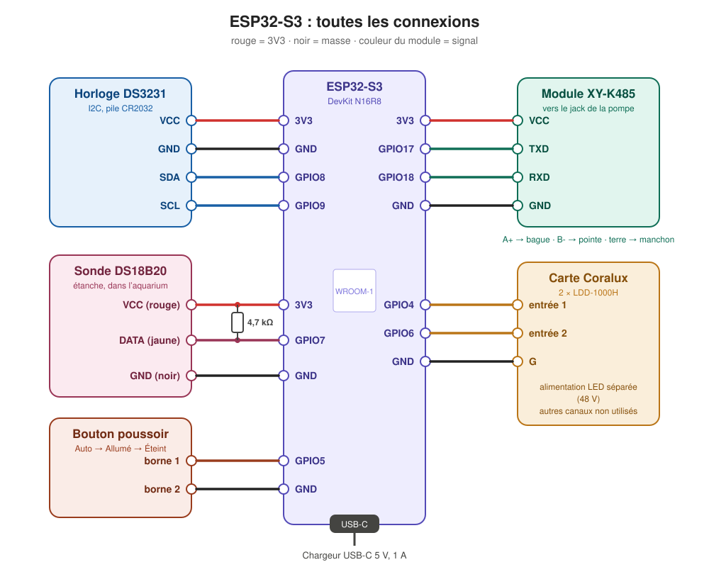
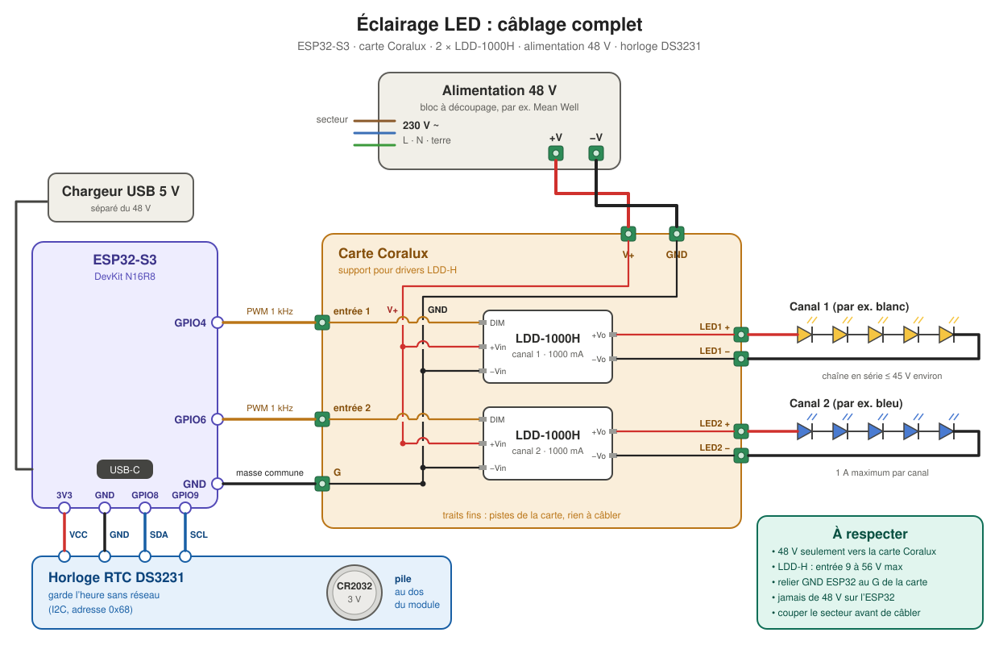
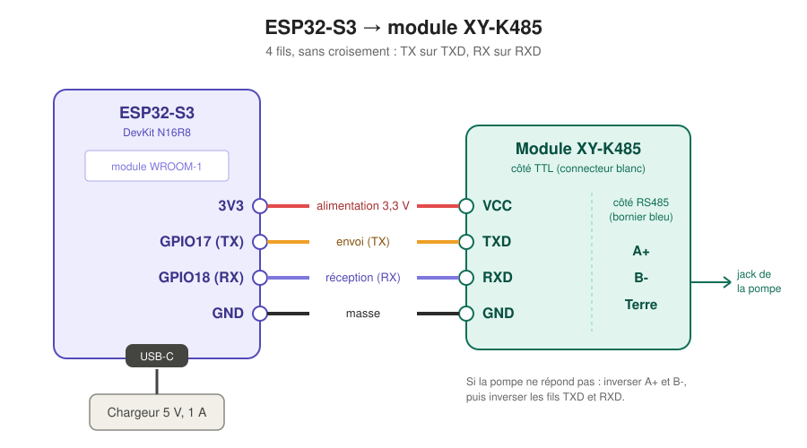
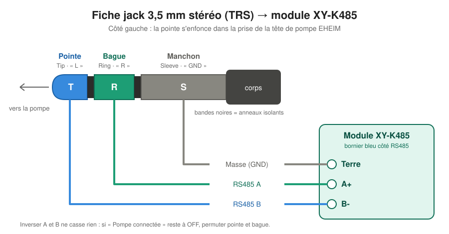

# eheim-3e-esphome-eclairage

Supervision et commande d'un filtre extérieur **EHEIM professionel 3e** et gestion autonome d'un **éclairage LED d'aquarium** (2 canaux, drivers LDD-1000H sur carte Coralux), avec un seul **ESP32-S3** sous **ESPHome**, intégré à **Home Assistant**.

- La pompe est pilotée par sa prise jack (bus RS485), sans le logiciel Windows EHEIM ControlCenter ni le câble USB d'origine.
- L'éclairage fonctionne **sans Home Assistant ni internet** : lever et coucher de soleil progressifs, horaires réglables, horloge sauvegardée par pile.

> Version filtre seul (sans éclairage) : [eheim-3e-esphome-et-home-assistant](https://github.com/apocalipse2701/eheim-3e-esphome-et-home-assistant)

---

## Sommaire

- [Fonctions](#fonctions)
- [Matériel](#matériel)
- [Schéma de branchement](#schéma-de-branchement)
- [Correspondance des broches](#correspondance-des-broches)
- [Installation](#installation)
- [Entités dans Home Assistant](#entités-dans-home-assistant)
- [Cartes pour le tableau de bord](#cartes-pour-le-tableau-de-bord)
- [Fonctionnement de l'éclairage](#fonctionnement-de-léclairage)
- [Modes de la pompe](#modes-de-la-pompe)
- [Tester la pompe depuis un PC](#tester-la-pompe-depuis-un-pc)
- [Dépannage](#dépannage)
- [Protocole](#protocole)
- [Avertissement](#avertissement)

---

## Fonctions

### Filtre EHEIM

Testé sur un **2076 (professionel 3e 450), firmware 3.80**. Devrait fonctionner avec les **2074 (350)** et **2078 (700)**.

- **Débit** : débit mesuré, débit de consigne, débit relatif (%)
- **Moteur** : vitesse du rotor, palier de débit actuel
- **Modes** : lecture et changement de mode — flux constant, Bio 12 h, Stream (pulsé), manuel
- **Réglages** : palier en flux constant (0 à 14), paliers et heure de début du mode Bio, paliers et durées du mode Stream, débit + / − en manuel
- **Entretien** : temps de fonctionnement, heures depuis et avant l'entretien, date du prochain entretien, encrassement (compteur)
- **Alertes** : erreur rotor, erreur air, erreur température, consigne non atteinte, débit faible (< 70 % de la consigne pendant 10 min)

### Éclairage LED

- **2 canaux** indépendants (PWM 1 kHz vers les entrées de la carte Coralux)
- **Lever et coucher de soleil** progressifs, heures et durées réglables
- **Intensité maximale** réglable par canal, **décalage** du canal 2 (avance au lever, retard au coucher)
- **Modes** : automatique, forcé allumé, forcé éteint ; retour automatique au mode auto au prochain lever ou coucher
- **Bouton physique** pour changer de mode sans téléphone
- **Autonome** : heure par internet (NTP) puis conservée par un module **DS3231** à pile ; l'éclairage continue si Home Assistant ou le Wi-Fi tombe
- Au redémarrage, le niveau correct est recalculé à partir de l'heure

### Commun

- **Page web locale** sur l'ESP32 (`http://eheim-3e.local`), utilisable sans Home Assistant
- **Cartes Lovelace** prêtes à coller (Mushroom)

---

## Matériel

| # | Élément | Rôle | Remarques |
|---|---|---|---|
| 1 | Filtre **EHEIM professionel 3e** (2074, 2076 ou 2078) | appareil supervisé | prise jack 3,5 mm sur la tête de pompe |
| 2 | **ESP32-S3 DevKit N16R8** (ESP32-S3-WROOM-1, 16 Mo flash, 8 Mo PSRAM) | microcontrôleur | broches données pour la N16R8 |
| 3 | Carte d'extension à borniers à vis pour ESP32-S3 | câblage sans soudure | facultative mais pratique |
| 4 | Module **TTL ↔ RS485 XY-K485** (3,3 V / 5 V, sens automatique) | interface avec le bus de la pompe | pas de broche DE/RE à piloter |
| 5 | Fiche **jack 3,5 mm mâle stéréo (3 points)** avec bornier à vis | connexion à la pompe | ou un câble audio jack coupé |
| 6 | **Carte Coralux** pour drivers LDD-H | support des drivers et entrées PWM | résistances de 10 kΩ déjà sur la carte |
| 7 | **2 × Mean Well LDD-1000H** | drivers LED à courant constant 1000 mA | un par canal ; LDD-H : PWM de 100 Hz à 1 kHz |
| 8 | **Alimentation 48 V** (bloc à découpage) | alimentation des drivers | LDD-H : entrée 9 à 56 V ; chaîne de LED jusqu'à 45 V environ ; puissance ≥ somme des LED + 10 % |
| 9 | Module **RTC DS3231** (avec pile CR2032) | horloge de secours | piloté comme un DS1307 dans ESPHome |
| 10 | **Bouton poussoir** (contact momentané) | changement de mode de l'éclairage | entre GPIO5 et GND, sans résistance |
| 11 | Chargeur **USB-C 5 V, 1 A minimum** + câble USB-C de qualité | alimentation de l'ESP32 | un câble trop fin provoque des redémarrages |
| 12 | Fils Dupont / fils de câblage | liaisons | |
| 13 | *(facultatif)* **EHEIM Interface 4020740** (câble USB d'origine) | test du protocole depuis un PC | inutile une fois l'ESP32 en place |
| 14 | *(facultatif)* Boîtier | protection près de l'aquarium | prévoir l'aération et éloigner de l'eau |

---

## Schéma de branchement



Version texte :

```
                        ┌──────────────────────────┐
  DS3231   VCC ◄────────┤ 3V3              3V3     ├────────► VCC   XY-K485 ──► jack pompe
           GND ◄────────┤ GND              GPIO17  ├────────► TXD
           SDA ◄────────┤ GPIO8            GPIO18  ├────────► RXD
           SCL ◄────────┤ GPIO9            GND     ├────────► GND
                        │                          │
  Bouton borne 1 ◄──────┤ GPIO5            GPIO4   ├────────► entrée 1   Carte Coralux
         borne 2 ◄──────┤ GND              GPIO6   ├────────► entrée 2   (2 × LDD-1000H)
                        │                  GND     ├────────► G
                        │        ESP32-S3          │
                        └────────────┬─────────────┘
                                 USB-C 5 V
```

### Éclairage : carte Coralux, LDD-1000H, alimentation 48 V et horloge



| De | Vers | Fil |
|---|---|---|
| Alimentation 48 V **+V** | Coralux **V+** | rouge, section adaptée au courant |
| Alimentation 48 V **−V** | Coralux **GND** | noir |
| ESP32 **GPIO4** | Coralux **entrée 1** (DIM du LDD canal 1) | signal PWM |
| ESP32 **GPIO6** | Coralux **entrée 2** (DIM du LDD canal 2) | signal PWM |
| ESP32 **GND** | Coralux **G** | masse commune, indispensable |
| Coralux **LED1 + / −** | chaîne de LED du canal 1 | respecter la polarité |
| Coralux **LED2 + / −** | chaîne de LED du canal 2 | respecter la polarité |
| ESP32 **3V3 / GND / GPIO8 / GPIO9** | DS3231 **VCC / GND / SDA / SCL** | pile CR2032 au dos du module |

Les repères exacts des borniers peuvent varier selon la version de la carte Coralux : se fier à sa sérigraphie. L'ESP32 reste alimenté par son chargeur USB 5 V, **jamais par le 48 V**.

### Filtre : jack de la pompe et module XY-K485





> **Ne pas alimenter l'ESP32 par le jack de la pompe** : ses trois contacts servent aux données (A, B) et à la masse.
>
> **Masse commune** : le GND de l'ESP32 doit être relié au G de la carte Coralux, sinon les drivers ne voient pas le signal PWM.

---

## Correspondance des broches

### Récapitulatif ESP32-S3

| Broche ESP32-S3 | Relié à | Rôle |
|---|---|---|
| **GPIO17** | XY-K485 TXD | envoi des trames vers la pompe |
| **GPIO18** | XY-K485 RXD | réception des réponses de la pompe |
| **GPIO4** | Coralux entrée 1 | PWM du canal 1 |
| **GPIO6** | Coralux entrée 2 | PWM du canal 2 |
| **GPIO8** | DS3231 SDA | données I2C |
| **GPIO9** | DS3231 SCL | horloge I2C |
| **GPIO5** | bouton (l'autre borne à GND) | changement de mode de l'éclairage |
| **3V3** | XY-K485 VCC, DS3231 VCC | alimentation des modules |
| **GND** | XY-K485 GND, DS3231 GND, Coralux G, bouton | masse commune |

Sur le XY-K485, TXD et RXD sont nommés du point de vue du microcontrôleur : on relie **TX à TXD** et **RX à RXD**, sans croiser.

### Module XY-K485 ↔ jack de la pompe

La pompe a une prise **jack 3,5 mm femelle**. Il faut une fiche **jack 3,5 mm mâle stéréo à 3 contacts** (TRS). Une fiche mono (2 contacts) ou casque-micro (4 contacts, TRRS) ne convient pas.

| Contact | Où sur la fiche | Marquage sur un adaptateur à bornier | Borne du XY-K485 |
|---|---|---|---|
| **Pointe** (T) | le bout arrondi | **L** (gauche) ou **T** | **B-** |
| **Bague** (R) | entre les deux anneaux isolants | **R** (droite) | **A+** |
| **Manchon** (S) | la longue partie côté corps | **G**, **GND**, **−**, terre ou **S** | **Terre** |

Inverser A et B ne casse rien : si « Pompe connectée » reste à OFF, permuter les fils de la pointe et de la bague.

### Broches à éviter sur la N16R8

| Broches | Raison |
|---|---|
| 35, 36, 37 | PSRAM octale |
| 19, 20 | USB natif |
| 43, 44 | UART0 (logs) |
| 0, 45, 46 | broches de démarrage |

---

## Installation

1. Copier `esphome/eheim-3e.yaml` et `esphome/eheim3e.h` dans le dossier ESPHome (`/config/esphome/` sous Home Assistant).
2. Copier `esphome/secrets.yaml.example` en `secrets.yaml` et le remplir (Wi-Fi, clé API, mots de passe OTA et page web).
3. Adapter si besoin le fuseau horaire (`timezone: Europe/Paris`) dans la section `time:`.
4. Dans **ESPHome Device Builder** : **Install** → « Brancher sur cet ordinateur » pour le premier flashage par USB (Chrome ou Edge), puis « Sur le réseau » pour les mises à jour suivantes.
   - Si le flashage échoue : maintenir **BOOT**, appuyer brièvement sur **RST**, relâcher **BOOT**, recommencer.
5. Ajouter l'appareil dans Home Assistant (notification « Nouvel appareil découvert ») avec la clé API.
6. Câbler (voir le schéma), vérifier que **Pompe connectée** passe à ON et régler les horaires d'éclairage.

Un seul maître sur le bus : le logiciel ControlCenter et l'ESP32 ne peuvent pas être branchés en même temps (la pompe n'a qu'une prise jack).

---

## Entités dans Home Assistant

| Type | Entités |
|---|---|
| Capteurs filtre | débit de consigne, débit mesuré, débit relatif, vitesse rotor, palier actuel, temps de fonctionnement, heures depuis entretien, heures avant entretien, encrassement (compteur), mode, prochain entretien |
| Alertes filtre | pompe en marche, erreur rotor, erreur air, erreur température, consigne non atteinte, débit faible |
| Commandes filtre | mode pompe, palier débit (flux constant), Bio : palier 12 premières heures / 12 heures suivantes / début, Stream : palier haut / bas, durée phase haute / basse, Manuel : débit plus / moins |
| Éclairage | éclairage canal 1, éclairage canal 2, mode éclairage, lever : heure de début / durée, coucher : heure de début / durée, intensité maximale canal 1 / 2, canal 2 : avance au lever / retard au coucher, retour auto au prochain lever/coucher, bouton éclairage |
| Diagnostic | pompe connectée, firmware pompe, type de pompe, courant (brut), mode (bits bruts), signal Wi-Fi, redémarrer |

---

## Cartes pour le tableau de bord

Le dossier [`home-assistant/`](home-assistant) contient :

| Fichier | Contenu |
|---|---|
| `carte-filtre.yaml` | carte du filtre : état, indicateurs, choix du mode par pastilles, réglages propres à chaque mode, entretien |
| `carte-eclairage.yaml` | carte de l'éclairage : mode, horaires, curseurs des deux canaux, réglages |
| `scripts.yaml` | scripts « palier + » et « palier − » utilisés par la carte du filtre |

Prérequis (via HACS) : **Mushroom** et **card-mod**. Ajout : tableau de bord → Modifier → Ajouter une carte → **Manuel**, puis coller le contenu du fichier.

Les noms d'entités supposent un appareil ESPHome nommé `eheim-3e` (préfixe `eheim_3e_`).

---

## Fonctionnement de l'éclairage

```
intensité
  max ┤          ┌───────────────────────────┐
      │         ╱                             ╲
      │        ╱                               ╲
    0 ┼───────┘                                 └────────
         début lever                       début coucher
         └─ durée ─┘                       └─ durée ─┘
```

- Toutes les 30 secondes, l'ESP32 calcule le niveau de chaque canal d'après l'heure et l'applique avec une transition douce. Après une coupure de courant, le bon niveau est retrouvé immédiatement.
- Le **décalage du canal 2** le fait démarrer plus tôt au lever et s'éteindre plus tard au coucher (valeur positive), ou l'inverse (valeur négative) : pratique pour un canal bleu ou « lune ».
- **Bouton** : chaque appui passe à Automatique → Forcé allumé → Forcé éteint.
- **Retour auto** : si activé, un mode forcé repasse en automatique au début du prochain lever ou coucher.
- **Heure** : synchronisée par NTP ; à chaque synchronisation, le DS3231 est mis à l'heure. Au démarrage, l'heure est relue sur le DS3231 : l'éclairage fonctionne même sans réseau.

---

## Modes de la pompe

Le sélecteur **Mode pompe** affiche le mode réel et envoie, lors d'un choix, la même séquence de commandes que le logiciel ControlCenter :

| Mode | Réglages utilisés | Remarques |
|---|---|---|
| **Flux constant** | palier débit (0 à 14) | le palier peut aussi être changé directement |
| **Bio 12 h** | palier des 12 premières heures, palier des 12 heures suivantes, heure de début | nécessite que l'ESP32 connaisse l'heure |
| **Stream** | palier haut, palier bas, durée de chaque phase (5 à 100 s) | |
| **Manuel** | boutons débit plus / moins | équivalent des touches de la pompe |

Les réglages Bio et Stream sont envoyés au moment où le mode est choisi : après une modification, choisir à nouveau le mode (bouton « Appliquer les réglages » sur la carte).

Les commandes passent par une file d'attente : un changement de mode prend 1 à 2 secondes.

---

## Tester la pompe depuis un PC

Avec le câble USB d'origine (EHEIM Interface 4020740), ControlCenter fermé :

```
pip install pyserial
python tools/eheim3e_test.py COM3
```

Remplacer `COM3` par le port affiché dans le Gestionnaire de périphériques (« USB Serial Port »). Le script ne fait que lire : firmware, type de pompe, puis les données toutes les 2 secondes.

---

## Dépannage

| Symptôme | Piste |
|---|---|
| « Pompe connectée » reste à OFF | inverser A+ et B- ; puis inverser TXD et RXD ; vérifier la masse commune |
| Les LED ne s'allument pas | masse commune ESP32 ↔ Coralux (G) ; alimentation des drivers ; mode éclairage sur « Forcé allumé » pour tester |
| Mauvaise heure d'éclairage | fuseau horaire dans `time:` ; pile du DS3231 ; câblage SDA / SCL |
| Le mode Bio ne s'active pas | l'ESP32 ne connaît pas encore l'heure (journal : « Heure inconnue ») |
| Le port COM n'apparaît pas au flashage | essayer l'autre prise USB-C de la carte ; utiliser Chrome ou Edge |
| Redémarrages de l'ESP32 | chargeur ou câble USB trop faible |
| « Consigne non atteinte » permanente | restriction hydraulique (robinets, crépine, tuyaux, masse filtrante) |

Pour le diagnostic du bus, passer `logger: level:` à `DEBUG` dans le YAML.

---

## Protocole

Liaison RS485 half-duplex à 115200 bauds, 8N1. Trames : `0x55 | adresse | longueur | commande | données`, sans checksum.

Description complète (commandes de lecture et d'écriture, structure des données, mot de mode, tables de débit) : [docs/protocole.md](docs/protocole.md)

---

## Avertissement

Projet personnel, non affilié à EHEIM GmbH & Co. KG, Mean Well ou Coralux. Les marques citées appartiennent à leurs propriétaires. Le protocole a été documenté à des fins d'interopérabilité ; aucun fichier du logiciel EHEIM n'est distribué ici. L'envoi de commandes d'écriture à la pompe et le câblage de l'alimentation LED se font à vos risques.

## Licence

MIT, voir [LICENSE](LICENSE).
